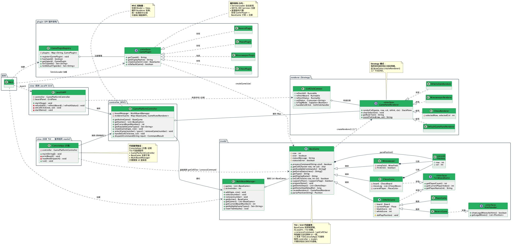

# Tessera

> *Tessera（拉丁语）：一块马赛克小方片、一枚棋子。*
> 六个 OOP 实验，从一个黑白棋小游戏，逐步拼成一个可扩展的多游戏平台。

**Tessera** 是面向对象程序设计课程 Lab1–Lab6 的连续迭代项目。每一阶段都在上一阶段的基础上重构与扩展：从终端黑白棋出发，依次加入完整规则、多对局并发、游戏抽象、扫雷、插件化架构、国际象棋，最终以 JavaFX 重写为一个图形化游戏大厅。

---

## 游戏一览

| 游戏 | typeId | 规则要点 |
|------|--------|----------|
| 和平棋 | `peace` | 8×8 棋盘，双方轮流落子，只占位不翻子，棋盘下满结束 |
| 黑白棋 / 翻转棋 | `reversi` | 标准黑白棋规则：合法落子判定、多方向翻子、无子可下时 pass、终局计分 |
| 扫雷 | `minesweeper` | 8×8 棋盘、10 颗雷，首开安全，支持插旗，翻开全部非雷格即胜利 |
| 国际象棋 | `chess` | 标准棋子走法，支持王车易位、吃过路兵、兵升变；王被吃掉即结束 |

---

## 实验演进

每个 `labN/` 都是一个**独立的 Maven 项目**，可以单独编译运行。

| Lab | 主题 | 新增能力 | 关键技术 |
|-----|------|----------|----------|
| [lab1](lab1) | 终端黑白棋基础版 | 可调棋盘大小、轮流落子、终端界面 | Lanterna、MVC 雏形 |
| [lab2](lab2) | 完整黑白棋规则 + 多对局 | 合法落子/翻子/弃权/胜负判定，3 个棋盘并发切换 | 分层重构、状态保持 |
| [lab3](lab3) | 游戏抽象与和平棋 | 抽出 `BaseGame` 模板基类，新增 `peace` 模式 | 模板方法、多态 |
| [lab4](lab4) | 终端小游戏平台 | 新增扫雷、动态新建对局、文案集中管理 | 统一输入与渲染、单一职责 |
| [lab5](lab5) | 插件化 + 国际象棋 | 新增 `chess`、demo 自动演示、SPI 插件加载 | `ServiceLoader`、开闭原则 |
| [lab6](lab6) | JavaFX 图形游戏大厅 | GUI 三栏布局、鼠标点击交互、可插拔渲染器 | JavaFX、MVC、策略模式 |

---

## 快速开始

### 环境要求

- **JDK**：Lab1–2 配置为 Java 11，Lab3–5 为 Java 16，Lab6 为 Java 23
- **Maven** 3.6+
- 能打开图形窗口的桌面环境（终端版通过 Lanterna 打开 Swing 窗口，Lab6 使用 JavaFX）

JavaFX 依赖由 Maven 自动下载，无需手动安装。

### 运行 Lab1–Lab5（终端版）

```bash
cd lab5          # 也可以是 lab1 ~ lab4
mvn -q exec:java
```

主类分别为：

- Lab1–Lab4：`com.othello.Main`
- Lab5：`com.gameplatform.Main`

### 运行 Lab6（JavaFX 图形版）

```bash
cd lab6
mvn -q javafx:run
```

### 运行测试

```bash
cd lab6
mvn test
```

目前 Lab6 包含国际象棋走法相关的单元测试（`ChessGameTest`）。

---

## 目录结构

```text
Tessera/
├── lab1/                  # 终端黑白棋基础版
├── lab2/                  # 完整黑白棋规则 + 多棋盘
├── lab3/                  # BaseGame 抽象 + 和平棋
├── lab4/                  # 扫雷 + 多游戏终端平台
├── lab5/                  # 国际象棋 + SPI 插件化 + demo 模式
└── lab6/                  # JavaFX 图形游戏大厅
    ├── README.md          # Lab6 详细说明
    ├── uml_class_diagram.png / .svg / .puml
    └── uml_package_diagram.puml
```

每个 Lab 的内部结构大致遵循：

```text
labN/
├── pom.xml
└── src/main/java/...
    ├── Main.java          # 入口
    ├── controller/        # 输入解析与流程控制
    ├── model/             # 棋盘、游戏规则、对局管理
    ├── view/              # 终端 / JavaFX 视图
    ├── plugin/            # 游戏插件（Lab5 起）
    ├── renderer/          # 渲染器（Lab6）
    └── games/             # 各游戏独立包（Lab5 起）
```

---

## 架构设计

### 1. 核心逻辑与界面解耦

所有游戏规则都放在 `model/` 与 `games/` 中，不依赖任何终端或图形库。Lab5 的终端界面与 Lab6 的 JavaFX 界面复用同一套核心逻辑，只替换表现层。

### 2. 模板方法：`BaseGame`

`BaseGame` 以 `final play()` 统一处理越界、占位、对局结束等公共校验，把具体落子规则留给子类的 `doPlay()` 实现：

```java
public final void play(Position position) {
    // 公共校验：对局是否结束、坐标是否合法、格子是否被占用
    if (doPlay(position)) {
        refreshScores();
    }
}

protected abstract boolean doPlay(Position position);
```

### 3. 插件化：SPI 动态加载

Lab5 起，每种游戏通过 `GamePlugin` 接口接入大厅，并由 `ServiceLoader` 自动发现：

```java
public interface GamePlugin {
    String getTypeId();
    String getDisplayName();
    BaseGame createGame(int size);
    boolean isDefaultGame();
}
```

注册文件位于 `src/main/resources/META-INF/services/com.gameplatform.plugin.GamePlugin`。新增游戏只需实现接口并注册，无需修改大厅核心代码。

### 4. 多对局管理

`MultiBoardManager` 负责创建、切换与保存多个对局。每个棋盘拥有完整独立的状态（局面、比分、当前回合），切换时不会丢失进度。

### 5. 渲染器策略（Lab6）

图形界面通过 `GamePanelRenderer` 接口为不同游戏提供各自的渲染方案：

- `OthelloStyleRenderer`：和平棋 / 黑白棋
- `MinesweeperRenderer`：扫雷
- `ChessRenderer`：国际象棋
- `DefaultGamePanelRenderer`：默认实现

新增游戏时，只需同时提供插件与渲染器，即可接入图形大厅。



---

## 操作速查

### Lab1–Lab5（终端版）

| 操作 | 输入 |
|------|------|
| 落子（黑白棋 / 和平棋） | `a1`、`1a` |
| 翻开 / 插旗（扫雷） | `a1` / `f a1`、`flag a1` |
| 移动棋子（国际象棋） | `m e2 e4`、`move e2 e4`，升变追加 `q` / `r` / `b` / `n` |
| 切换对局 | `2`、`s 2`、`switch 2` |
| 新建对局 | `peace`、`reversi`、`minesweeper`、`chess` |
| 黑白棋 pass | `pass` |
| 自动演示（Lab5） | `demo` |
| 退出 | `quit` |

### Lab6（图形版）

- **鼠标**：点击棋盘落子 / 翻开；扫雷右键插旗；国际象棋先选己方棋子再点目标格
- **按钮**：`Pass`、`Flag`、`Quit`
- **输入栏**：支持与终端版相同的指令
- **右侧列表**：点击切换对局，按钮新建对局

---

## 文档索引

| 文档 | 内容 |
|------|------|
| [lab2/黑白棋游戏实现Spec.md](lab2/黑白棋游戏实现Spec.md) | 黑白棋完整规则与重构要求 |
| [lab2/多对局并发运行Spec.md](lab2/多对局并发运行Spec.md) | 多棋盘切换与状态保持需求 |
| [lab4/README.md](lab4/README.md) | Lab4 终端平台说明 |
| [lab5/lab5.md](lab5/lab5.md) | Lab5 任务书原文 |
| [lab5/README.md](lab5/README.md) | Lab5 终端平台说明 |
| [lab6/README.md](lab6/README.md) | Lab6 JavaFX 平台详细说明 |
| [lab6/5. lab分析_准备.md](lab6/5.%20lab分析_准备.md) | Lab6 架构分析要点 |

各 Lab 目录下的实验报告 PDF 包含更详细的设计说明与测试记录。

---

## 说明

本项目为面向对象程序设计课程实验作业，代码与文档仅用于学习与交流。
